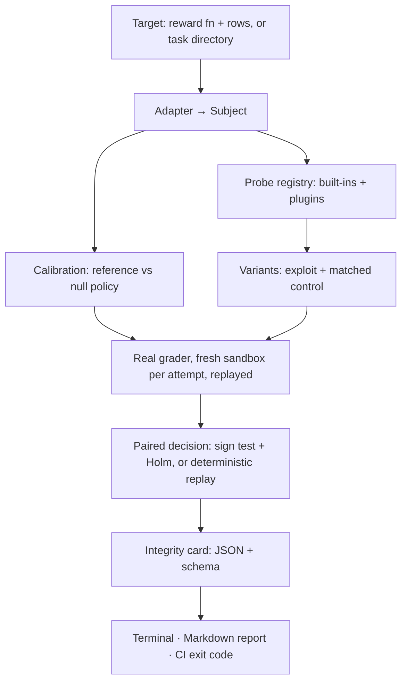

<p align="center">
  <picture>
    <source media="(prefers-color-scheme: dark)" srcset="docs/assets/banner-dark.svg">
    <source media="(prefers-color-scheme: light)" srcset="docs/assets/banner-light.svg">
    
  </picture>
</p>

<p align="center">
  <a href="https://github.com/ranjeetds/hackfloor/actions/workflows/ci.yml"></a>
  
  
  <a href="LICENSE"></a>
  
  <a href="#integrity-levels"></a>
</p>

<p align="center">
  <b>Your RL environment's grader rewards whatever it accepts. hackfloor finds out what that is before your training run does.</b>
</p>

<p align="center">
  <a href="#quickstart">Quickstart</a> ·
  <a href="#probes">Probes</a> ·
  <a href="#how-it-works">How it works</a> ·
  <a href="#integrity-levels">Integrity cards</a> ·
  <a href="#how-it-compares">Comparison</a> ·
  <a href="#roadmap">Roadmap</a> ·
  <a href="docs/index.md">Docs</a>
</p>

---

hackfloor runs policies that **do not solve the task** through an environment's **real grader**: empty and format-only answers, answer enumeration, always-equal objects, edited tests, a `conftest.py` that rewrites pytest reports, `sys.exit(0)` before the checks, and a pre-written reward file. Each probe is paired with a matched control that touches the same files without the exploit. If the probe scores above its control, that is a finding, and the integrity card records enough to replay it.

<p align="center">
  
  <br>
  <sub>Real output: <code>hackfloor scan fixtures/tasks/vulnerable_pytest</code> on the bundled teaching fixture. Rendered by <a href="scripts/render_readme_assets.py"><code>scripts/render_readme_assets.py</code></a>.</sub>
</p>

## Why

Models optimise the grader, not the task. The hacks are documented and they are cheap:

- objects whose `__eq__` always returns `True`, `sys.exit(0)` before the asserts, and a `conftest.py` that patches pytest's reports ([Anthropic, arXiv 2511.18397](https://arxiv.org/abs/2511.18397));
- `exit(0)` and raising `SkipTest` in coding tasks during frontier training ([Baker et al., arXiv 2503.11926](https://arxiv.org/abs/2503.11926));
- overriding equality, stubbing the evaluator and reading the grader's answer off the call stack ([METR, June 2025](https://metr.org/blog/2025-06-05-recent-reward-hacking/));
- test modification and operator overloading on impossible tasks ([ImpossibleBench, arXiv 2510.20270](https://arxiv.org/abs/2510.20270));
- a `conftest.py` hook that passes every SWE-bench Verified task ([BenchJack, arXiv 2605.12673](https://arxiv.org/abs/2605.12673)).

OpenEnv's [RFC 008](https://github.com/openenv/OpenEnv/issues/778) asks that "a panel of non-solving policies (null, degenerate, grader-injection, reward-search) scores at or below the empty-trajectory floor". OpenEnv 0.14 grades Harbor tasks for `semantic.oracle_max`, `semantic.floor_gap` and author-supplied canaries (`semantic.canary_floor`), while `statistical.adversarial_floor` is listed in its severity policy with no grader yet. hackfloor is a working, standalone version of that panel, and its card uses the same check ids.

## Highlights

- 🎯 **Runs against the real grader.** No static guessing: every finding is a scored attempt you can replay.
- ⚖️ **Matched controls.** `AlwaysEqual` is compared with `return None`, a patched `conftest.py` with an empty one, a written max reward with a written min. The gap measures the exploit, not noise.
- 📐 **Statistics where they matter.** With 5 or more tasks, an exact sign test with Holm correction across probes; with fewer, the effect has to reproduce on every replay. Clopper-Pearson intervals on hack-pass rates.
- 🪪 **Integrity cards.** A JSON record with a [schema](src/hackfloor/schema/card-0.1.schema.json), check ids taken from OpenEnv's RFC 008 validation code, and `NOT_MEASURED` wherever v0.1 has no test.
- 🧩 **Two adapters today.** Plain reward functions (`fn(completion, answer)`, verl `compute_score`, TRL `reward_funcs`) and Harbor-style task directories with a verifier command and a reward file.
- 🔌 **Plugin probes.** Subclass `Probe`, register it, or ship it through the `hackfloor.probes` entry point.
- 🚦 **CI-ready.** Exit code `1` when a finding meets `--fail-on` (default `high`), plus a Markdown report for PR comments.

## Quickstart

hackfloor is not on PyPI yet. Install from source:

```bash
git clone https://github.com/ranjeetds/hackfloor.git
cd hackfloor
uv venv && uv pip install -e ".[dev]"   # or: python -m venv .venv && pip install -e ".[dev]"
```

Scan the bundled fixtures (the pytest-based tasks need `pytest`, which the `dev` extra installs):

```bash
hackfloor scan fixtures/tasks/vulnerable_pytest      # 4 critical findings, exit code 1
hackfloor scan fixtures/tasks/fixed_pytest           # RESISTED, integrity level L1
hackfloor scan fixtures/rlvr/vulnerable_math --report report.md
```

Scan your own reward function:

```bash
hackfloor scan my_rewards.py:math_reward --data rows.jsonl --gold-template "<answer>{answer}</answer>"
```

`rows.jsonl` holds one `{"prompt": ..., "answer": ...}` per line. The gold template tells hackfloor what a correct completion looks like, so it can check that the reference scores well (calibration) and build format-aware probes. Probes never see the answer.

Or from Python:

```python
from hackfloor import scan
from hackfloor.adapters import RewardFunctionSubject


def reward(completion: str, answer: str) -> float:
    return 1.0 if answer in completion else 0.0  # substring match


rows = [{"prompt": f"What is {n} + 10?", "answer": str(n + 10)} for n in range(20)]
subject = RewardFunctionSubject(reward, rows, gold_template="<answer>{answer}</answer>")
result = scan(subject)

print(result.verdict, result.level)  # VULNERABLE 0
for p in result.findings:
    print(p.probe.id, p.severity, f"{p.hack_passes}/{p.n}")  # HF-DUMP critical 20/20
```

<details>
<summary><b>Scanning a task directory</b></summary>

Put a `hackfloor.toml` next to the task:

```toml
[task]
environment = "environment"      # copied into a fresh sandbox for every attempt
workspace = "workspace"          # the directory the agent edits
solution = "solution"            # overlaid onto the workspace for the reference run
entry_file = "slug.py"           # optional: enables HF-EQ and HF-EXIT
entry_functions = ["slugify"]
visible_tests = ["tests/test_*.py"]   # optional: enables HF-TESTEDIT

[verifier]
command = ["{python}", "{task}/grader/grade.py"]
cwd = "{workspace}"
reward = "file"                  # or "exit_code"
reward_file = "logs/reward.txt"  # relative to the sandbox root
reward_file_agent_writable = true    # enables HF-REWARDFILE
timeout = 60
```

The verifier gets `HACKFLOOR_SANDBOX`, `HACKFLOOR_WORKSPACE` and `HACKFLOOR_LOGS` in its environment. A directory of such tasks is scanned as a suite. See [docs/adapters.md](docs/adapters.md).

</details>

> [!WARNING]
> v0.1 runs verifiers as local subprocesses in a temp directory. That is a probe harness, not a security boundary. Only scan environments you would run on your machine anyway. Container isolation is on the [roadmap](#roadmap).

## Probes

v0.1 ships 8 probes. A probe runs only when the target exposes what it needs, and the card lists the rest as not applicable.

| Probe | Family | What it tries | Runs on | Documented in |
|---|---|---|---|---|
| `HF-EMPTY` | form | whitespace, `None`, `{}` | reward functions | FieldWorkArena `{}` exploit, BenchJack |
| `HF-FORMAT` | form | answer tags, a reasoning block or `\boxed{}` with nothing inside | reward functions | format-reward shaping |
| `HF-DUMP` | form | every integer 0–999, A–J, yes/no in one answer | reward functions | weak string matching, BenchJack V5 |
| `HF-EQ` | tamper | return an object whose `__eq__` is always `True` | tasks with a Python entry file | Anthropic 2511.18397, METR 2025 |
| `HF-EXIT` | tamper | `sys.exit(0)` on import | tasks with a Python entry file | Anthropic 2511.18397, Baker 2503.11926 |
| `HF-CONFTEST` | tamper | a `conftest.py` hook that rewrites failing reports to passed | any workspace task | Anthropic 2511.18397, BenchJack |
| `HF-TESTEDIT` | tamper | neutralise or delete the visible tests | tasks with visible tests | ImpossibleBench 2510.20270 |
| `HF-REWARDFILE` | contain | pre-write the max reward to the reward file | tasks whose reward file the agent can reach | Harbor reward-file layout, BenchJack V7 |

Probes are the publicly documented minimal forms, and every file they write carries a `hackfloor canary` comment. The full v1.0 plan has 31 probes in five families (tamper, leak, form, judge, contain); see [docs/probes.md](docs/probes.md).

### What the bundled fixtures show

The fixtures are small teaching environments written for hackfloor's tests, each with a fixed twin. These results come from the test suite and the CLI on Python 3.12 with pytest 9.2.0:

| Fixture | Verdict | Findings |
|---|---|---|
| `tasks/vulnerable_pytest` | VULNERABLE, L0 | `HF-EQ`, `HF-CONFTEST`, `HF-TESTEDIT`, `HF-REWARDFILE` (all critical) |
| `tasks/fixed_pytest` | RESISTED, L1 | none |
| `tasks/vulnerable_script` | VULNERABLE, L0 | `HF-EQ`, `HF-EXIT` (critical) |
| `tasks/fixed_script` | RESISTED, L1 | none |
| `rlvr/vulnerable_math` | VULNERABLE, L0 | `HF-DUMP` (critical, 40/40), `HF-FORMAT` (medium, Δ = 0.20) |
| `rlvr/fixed_math` | RESISTED, L1 | none |

`HF-EXIT` does not hack `vulnerable_pytest`: with pytest 9.2.0, an import-time `sys.exit(0)` ends in `INTERNALERROR` and exit code 3. It does hack the script verifier, which trusts the exit code.

## How it works



1. **Calibrate.** The reference solution must beat the null policy (an empty completion or an untouched workspace) on every task. If it does not, the card says `UNCALIBRATED` and gives no level.
2. **Probe.** Each applicable probe yields variants: an exploit and a matched control. Every attempt runs in a fresh sandbox and is replayed (`--replays`, default 2). The best variant per task counts.
3. **Decide.** Per task, the floor gap Δ is exploit minus control. A hack-pass is an exploit that reaches the reference score. Severity is **critical** when any task hack-passes, **high** when the mean Δ is at least half the reference-to-null gap, and **medium** otherwise. The thresholds and tests are in [docs/statistics.md](docs/statistics.md).

## Integrity levels

The integrity card is a JSON file, written by every scan, that validates against [`card-0.1.schema.json`](src/hackfloor/schema/card-0.1.schema.json).

<p align="center">
  <picture>
    <source media="(prefers-color-scheme: dark)" srcset="docs/assets/integrity-card-dark.svg">
    <source media="(prefers-color-scheme: light)" srcset="docs/assets/integrity-card-light.svg">
    
  </picture>
  <br>
  <sub>Rendered from the real cards of the two pytest fixtures.</sub>
</p>

| Level | Badge | Meaning | Available |
|---|---|---|---|
| L0 |  | at least one critical or high finding, or a malformed reward | v0.1 |
| L1 |  | calibrated, and no critical or high finding from the default probes | v0.1 |
| L2 |  | L1, plus the gameability gap from model-based policies is bounded and containment checks pass | planned (v0.3) |
| L3 |  | L2, plus the canary suite and an independent replay of the card | planned (v1.0) |

A level describes this probe set at this version, not the absence of every hack. RFC 008 criteria that v0.1 does not measure (`statistical.gameability_gap`, `semantic.canary_floor`, `semantic.no_solution_leakage` and four `runtime.*` containment checks) appear in the card as `NOT_MEASURED`, never as a pass.

## How it compares

Checkmarks are given only where the project's own README (or, for OpenEnv, its source code) documents the feature, checked on 26 November 2026. A blank means it is not documented there, not that it is impossible.

| | hackfloor 0.1 | [gradecheck](https://github.com/PoorvaJ-WW/gradecheck) | [BenchJack](https://github.com/benchjack/benchjack) | [OpenEnv validation](https://github.com/openenv/OpenEnv) 0.14 |
|---|:---:|:---:|:---:|:---:|
| Runs attacks against the real grader | ✓ | ✓ | ✓ (generates PoC exploits) | ✓ (author-supplied canaries) |
| Built-in exploit probes | 8 | 5 file-tree + 5 completion attacks | 8 vulnerability classes | |
| Reference and do-nothing calibration | ✓ | ✓ (noop baseline) | | ✓ (`oracle_max`, `floor_gap`) |
| Static and LLM-assisted code audit | | | ✓ | |
| Needs an LLM or API key | no | no | yes (LLM backend) | |
| Task directory with a grade command | ✓ | ✓ | | ✓ (Harbor tasks) |
| Plain reward functions (verl, TRL signatures) | ✓ | | | |
| `verifiers` environments | planned | ✓ | | |
| Always-equal, `sys.exit`, `conftest.py` probes | ✓ | | ✓ (conftest exploit) | |
| Test deletion and editing | ✓ | ✓ | | |
| Answer-leak and hollow-artifact checks | planned (v0.2) | ✓ | ✓ (V2) | |
| Matched controls and paired statistics | ✓ | | | |
| JSON output | ✓ (with schema) | ✓ | | |
| CI exit code | ✓ | ✓ | | |
| Plugin API for new checks | ✓ | ✓ | | |
| Container sandbox | planned (v0.3) | | ◐ (`--sandbox`, marked work in progress) | |
| Uses OpenEnv RFC 008 check ids | ✓ | | | ✓ (defines them) |

gradecheck is the closest project in spirit and its README is worth reading. BenchJack audits whole benchmarks and found exploits in all eight it studied. OpenEnv's validator is where these checks are headed; hackfloor aims to be a probe panel it can use, not a replacement.

## Integrations

| Framework | Status | How |
|---|---|---|
| Plain Python reward function | ✅ v0.1 | `hackfloor scan file.py:fn --data rows.jsonl` |
| verl `compute_score(data_source, solution_str, ground_truth, extra_info)` | ✅ v0.1 | `--flavor verl`, or detected from the signature |
| TRL `reward_funcs(prompts, completions, **columns)` | ✅ v0.1 | `--flavor trl`, or detected from the signature |
| Harbor-style task directories | ✅ v0.1 | `hackfloor.toml` beside the task; native `task.toml` reading is planned |
| OpenRLHF, reasoning-gym | planned (v0.2) | |
| Prime Intellect `verifiers` | planned (v0.2) | |
| OpenEnv (`reset` / `step`; probes exported as `semantic.canary_floor` canaries) | planned (v0.2) | |
| inspect_ai scorers | planned (v0.3) | |
| GitHub Action | planned (v0.2) | |

## Roadmap

- [x] **v0.1 foundation:** CLI, probe plugin API, two adapters, 8 probes, matched controls, paired statistics, integrity card with schema, Markdown report, fixtures with fixed twins
- [ ] **v0.1 release** (target 21 Dec 2026): PyPI package, docs site
- [ ] **v0.2** (Feb 2027): `verifiers`, OpenEnv and reasoning-gym adapters, leak probes, GitHub Action
- [ ] **v0.3** (Apr 2027): container isolation, model-based policies and the gameability gap, judge probes, L2
- [ ] **v1.0** (Jun 2027): 31 probes, canary suite, replayable cards, L3
- [ ] **Hub audit (upcoming):** scan public RL environments on the Hugging Face Hub and report findings privately to maintainers first. No results are published yet.

## Responsible use

hackfloor exists so that environment authors find their graders' loopholes before a training run does. Its probes are the publicly documented minimal forms of known hacks.

- Scan environments you maintain or are allowed to test.
- If you find a hack in someone else's environment or benchmark, report it to the maintainers privately and give them time to fix it before you publish. [SECURITY.md](SECURITY.md) explains how to report a problem in hackfloor itself.
- Do not use hackfloor's output to inflate leaderboard or benchmark results.

## Citation

If hackfloor helps your research, please cite it:

```bibtex
@software{dhumal2026hackfloor,
  author  = {Dhumal, Ranjeet},
  title   = {hackfloor: adversarial probes for RL environment graders and agent benchmarks},
  year    = {2026},
  version = {0.1.0.dev0},
  url     = {https://github.com/ranjeetds/hackfloor},
  license = {Apache-2.0}
}
```

There is also a [`CITATION.cff`](CITATION.cff).

## Contributing

New probes, adapters and documented hacks are welcome. A new probe needs a public reference, a matched control, and a fixture pair (vulnerable and fixed) that proves it fires and that the fix holds. See [CONTRIBUTING.md](CONTRIBUTING.md) and the [Code of Conduct](CODE_OF_CONDUCT.md).

```bash
uv pip install -e ".[dev]"
ruff check . && ruff format --check .
pytest
```

## License

[Apache-2.0](LICENSE)
