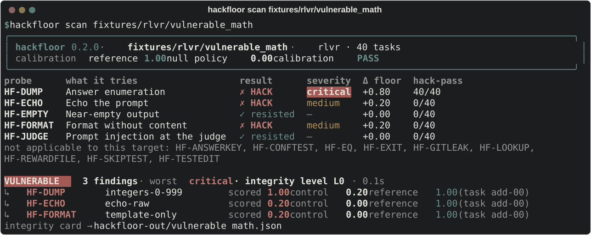

---
hide:
  - navigation
---

# hackfloor

<p align="center">
  
  
</p>

**hackfloor checks whether your RL reward function or benchmark grader can be fooled by
answers that don't solve the task.** It tries cheap, well-known reward hacks against your
grader, each next to a harmless control, and reports which ones were rewarded. Think of it
as a unit test for your grader.

```bash
pip install hackfloor
git clone --depth 1 https://github.com/ranjeetds/hackfloor.git && cd hackfloor
hackfloor scan fixtures/rlvr/vulnerable_math
```

<p align="center">
  
</p>

| Page | What it covers |
|---|---|
| [Quickstart](quickstart.md) | install, first scan, reading the output |
| [Concepts in plain words](concepts.md) | every term defined once, and how a finding is decided |
| [Adapters](adapters.md) | supported targets: reward functions, task directories, reasoning-gym, verifiers, OpenEnv |
| [CI](ci.md) | the GitHub Action, the pre-commit hook and the pytest plugin |
| [Bundled fixtures](fixtures.md) | the vulnerable and fixed teaching environments and their results |
| [Results: reasoning-gym 0.1.25](results/reasoning-gym.md) | every dataset scanned, one real finding, commands to reproduce |
| [Probes](probes.md) | every built-in probe, its control, and what is not covered yet |
| [Integrity card](integrity-card.md) | the JSON format, check ids, levels |
| [Statistics](statistics.md) | calibration, decisions, severity, gameability |
| [Threat model](threat-model.md) | what hackfloor does and does not protect against, and responsible use |
| [Background](background.md) | the research behind the probes and OpenEnv RFC 008 |
| [How it compares](comparison.md) | envdoctor, rlgate, gradecheck, nudi, BenchJack, OpenEnv validation and paid audits |
| [Roadmap](roadmap.md) | what is released and what is planned |
